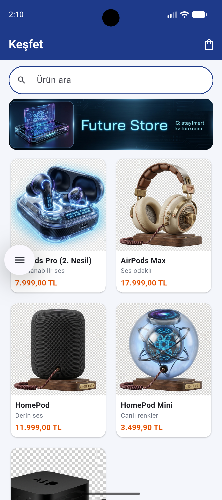
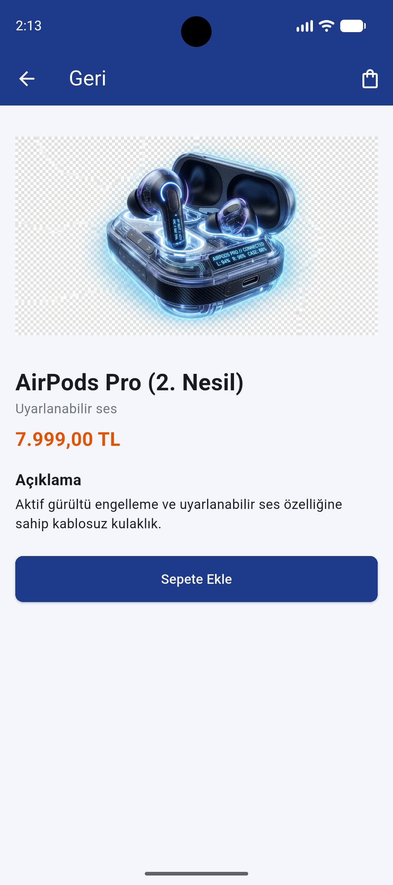
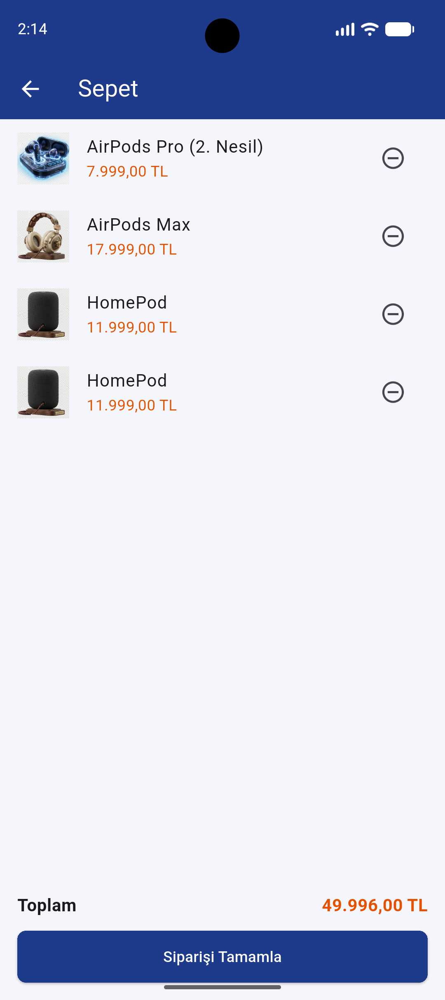
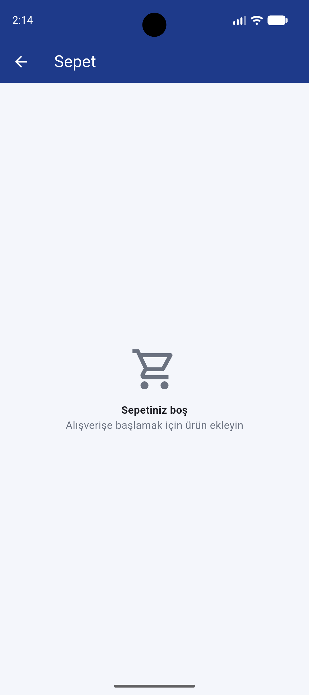

# Mini Katalog / Mini Catalog

**[Türkçe](#türkçe) | [English](#english)**

---

## Türkçe

Flutter ile geliştirilmiş, ürünlerin listelendiği basit bir mobil katalog uygulaması.

### Kısa Açıklama

Mini Katalog; ana sayfada ürünleri GridView ile kart olarak gösterir, ürün detayına geçişi ve basit bir sepet simülasyonunu içerir. Ürün verileri, ekstra paket kullanılmadan `assets/data/products.json` dosyasından okunur. Bu proje, Flutter eğitimi kapsamında widget yapısı, sayfa geçişleri, temel UI tasarımı, veri modeli oluşturma ve proje klasörleme mantığını öğrenmek amacıyla hazırlanmıştır.

### Özellikler

- Ana sayfa, ürün detayı ve sepet ekranları
- Named Routes ile sayfa geçişleri (`/`, `/detay`, `/sepet`)
- Route Arguments ile ürün verisi taşıma
- GridView ile kart tabanlı ürün listesi
- JSON dosyasından veri okuma ve `Product` model sınıfı (`fromJson` / `toJson`)
- Ürün adına göre arama
- Sepete ekleme, sepetten çıkarma, toplam tutar ve boş sepet ekranı
- Sepet rozeti (sepetteki ürün sayısı)
- Türkçe arayüz ve TL para birimi (örn. `7.999,00 TL`)
- Renk paleti ve fiyat formatı `lib/constants.dart` dosyasında tek yerden yönetilir
- Ekstra paket kullanılmamıştır (yalnızca Flutter SDK)

### Kullanılan Sürümler

| Araç | Sürüm |
|---|---|
| Flutter | 3.50.0 (stable) |
| Dart | 3.14.0 |

### Çalıştırma Adımları

1. Flutter SDK'nın kurulu olduğundan emin olun ve sürümü kontrol edin:
   ```
   flutter --version
   ```
2. Repoyu klonlayın:
   ```
   git clone https://github.com/jawixa/mini_katalog
   cd mini_katalog
   ```
3. Bağımlılıkları yükleyin:
   ```
   flutter pub get
   ```
4. Bir Android emülatörü başlatın veya Android cihaz bağlayın, ardından cihazın göründüğünü doğrulayın:
   ```
   flutter devices
   ```
5. Uygulamayı çalıştırın:
   ```
   flutter run
   ```

> İlk derleme, Gradle bağımlılıkları indirileceği için birkaç dakika sürebilir.

### Proje Yapısı

```
mini_katalog/
├── assets/
│   ├── data/
│   │   └── products.json     # Ürün verileri (JSON simülasyonu)
│   └── images/               # Ürün görselleri ve banner
├── lib/
│   ├── main.dart             # Uygulama girişi, tema ve route tanımları
│   ├── constants.dart        # Renkler ve fiyat formatı
│   ├── cart.dart             # Basit sepet durumu (ValueNotifier)
│   ├── models/
│   │   └── product.dart      # Product model sınıfı
│   └── pages/
│       ├── home_page.dart    # Ana sayfa: arama, banner, ürün grid'i
│       ├── detail_page.dart  # Ürün detayı
│       └── cart_page.dart    # Sepet
└── pubspec.yaml
```

### Ekran Görüntüleri

| Ana Sayfa | Ürün Detayı | Sepet | Boş Sepet |
|---|---|---|---|
|  |  |  |  |

### Notlar

- Banner ve Ürün görselleri bana aittir ve `assets/images/` konumundadır.
- Ürün fiyatları örnek değerlerdir, gerçek bir e-ticaret altyapısını temsil etmez.
- Sepet ve sipariş işlemleri yalnızca simülasyondur, kalıcı veri tutulmaz.

[⬆ Başa dön](#mini-katalog--mini-catalog)

---

## English

A simple mobile catalog app built with Flutter that lists products.

### Short Description

Mini Catalog shows products as cards in a GridView on the home page, and includes a product detail page and a simple cart simulation. Product data is read from `assets/data/products.json` without any extra packages. This project was prepared as part of a Flutter training to learn widget structure, page navigation, basic UI design, data modeling and project folder organization.

### Features

- Home, product detail and cart screens
- Page navigation with Named Routes (`/`, `/detay`, `/sepet`)
- Passing product data with Route Arguments
- Card-based product list with GridView
- Reading data from a JSON file and a `Product` model class (`fromJson` / `toJson`)
- Search by product name
- Add to cart, remove from cart, total price and an empty cart screen
- Cart badge (number of items in the cart)
- Turkish interface and TL currency (e.g. `7.999,00 TL`)
- Color palette and price format are managed in one place: `lib/constants.dart`
- No extra packages used (Flutter SDK only)

### Versions Used

| Tool | Version |
|---|---|
| Flutter | 3.50.0 (stable) |
| Dart | 3.14.0 |

### How to Run

1. Make sure the Flutter SDK is installed and check its version:
   ```
   flutter --version
   ```
2. Clone the repository:
   ```
   git clone https://github.com/jawixa/mini_katalog
   cd mini_katalog
   ```
3. Install dependencies:
   ```
   flutter pub get
   ```
4. Start an Android emulator or connect an Android device, then verify the device is detected:
   ```
   flutter devices
   ```
5. Run the app:
   ```
   flutter run
   ```

> The first build may take a few minutes because Gradle dependencies are downloaded.

### Project Structure

```
mini_katalog/
├── assets/
│   ├── data/
│   │   └── products.json     # Product data (JSON simulation)
│   └── images/               # Product images and banner
├── lib/
│   ├── main.dart             # App entry point, theme and route definitions
│   ├── constants.dart        # Colors and price format
│   ├── cart.dart             # Simple cart state (ValueNotifier)
│   ├── models/
│   │   └── product.dart      # Product model class
│   └── pages/
│       ├── home_page.dart    # Home: search, banner, product grid
│       ├── detail_page.dart  # Product detail
│       └── cart_page.dart    # Cart
└── pubspec.yaml
```

### Screenshots

| Home | Product Detail | Cart | Empty Cart |
|---|---|---|---|
|  |  |  |  |

### Notes

- The banner and product images belong to me and are located in the assets/images/ directory.
- Product prices are sample values and do not represent a real e-commerce backend.
- Cart and checkout actions are simulations only; no data is stored permanently.

[⬆ Back to top](#mini-katalog--mini-catalog)